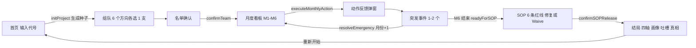

I'll read all five files first.
# 《带队吧，总监》代码评审报告

> 按你的要求，这次评审只做了读文件。我没有执行任何命令，也没有改动任何文件。下面的结论全部来自对 5 个源文件的通读，以及按代码逻辑做的推算。

## 0. 结论

| 维度 | 评价 |
|---|---|
| 项目定位 | 纯前端、单页、移动端尺寸的**管理模拟游戏**：玩家扮演智驾量产研发总监，6 个月回合制，最后在 SOP（量产放行）前决定 6 条质量红线 |
| 架构 | **分层清楚**：静态数据（`game-data.js`）、规则引擎（`game-engine.js`，不碰 DOM，Node 和浏览器都能加载）、界面控制（`app.js`）。随机数完全由项目代号决定，同一代号必定复现同一局 |
| 最严重问题 | **有 3 个高危 bug**：① 突发事件抽完后月份不再推进，玩家被卡死（约 5.8% 的代号会中）；② 预算一旦为负，连零成本动作也被禁用，玩家被卡死；③ SOP 修复的预算不按累计校验，确认时扣到一半抛异常，状态被写坏 |
| 次要问题 | 几处机制写了但不生效：「目标对齐度」灯在正常玩法下永远是红灯；多处「升一级/降一级」的效果被马上覆盖；「盲人总监」判定的字段名写错；士气不计入最终评分；A 级评价几乎拿不到 |
| 总体建议 | 先修 3 个卡死/写坏状态的问题（P0），再修数值和设计 bug、补上真正有效的测试（P1），最后做配置集中、无障碍和清理死代码（P2） |

---

## 1. 项目是什么

| 项 | 内容 |
|---|---|
| 名称 | 《带队吧，总监 — 智驾量产沙盘（纯管理者版）》 |
| 类型 | 浏览器单页文字策略游戏，界面最宽 480px，深色主题 |
| 核心玩法 | 6 个方向（感知、规控、功能安全、数据闭环、车企对接、实车路测）各从 2 支队伍里选 1 支，然后 M1–M6 每月选 1 个管理动作（共 8 种），再处理 1–2 个突发事件（A/B/C 三选一）。M6 结束后对 6 条质量红线逐条选「修复」或「Waive（带风险放行）」，最后给出四轴评分、评级、管理风格画像、团队匿名吐槽和真相复盘 |
| 设计主题 | 古德哈特定律：各组周报有「水分」，真实质量是隐藏值，只有做「隔级摸底」才能看到真值 |
| 技术特点 | 零依赖；自己实现了 SHA-256 和 Mulberry32 伪随机，全程不调用 `Math.random()`；同一项目代号可复现同一局 |

## 2. 怎么运行

| 方式 | 步骤 | 说明 |
|---|---|---|
| 直接打开 | 用浏览器打开 `index.html` | 只用普通 `<script>` 标签，没有 ES 模块和 fetch，`file://` 下也能跑 |
| 静态服务器 | 在项目目录起任意静态服务（例如 `python3 -m http.server 8000`），访问 `http://localhost:8000/` | 推荐方式 |
| 调试模式 | URL 后加 `?debug=1` | 顶部显示种子、预算、士气和 6 个方向的真实质量（[app.js#L22-L32](file:///workspace/manager-edition-review/app.js#L22-L32)） |
| 引擎自测 | 在 Node 中 `require('./game-engine.js').runPRDTests()` | 引擎是 UMD 写法（[game-engine.js#L1466-L1478](file:///workspace/manager-edition-review/game-engine.js#L1466-L1478)）。界面没有接入这套测试；按要求我没有执行它 |

## 3. 代码结构

### 3.1 文件职责

| 文件 | 行数 | 职责 |
|---|---|---|
| [index.html](file:///workspace/manager-edition-review/index.html) | 360 | 7 个页面（首页、组队、名单确认、月度看板、突发事件、SOP、结局）加 2 个弹窗（选动作、动作反馈），全部静态写好，靠 `.screen.active` 切换显示 |
| [style.css](file:///workspace/manager-edition-review/style.css) | 1141 | CSS 变量主题、组件样式、底部固定操作栏、底部抽屉式弹窗 |
| [game-data.js](file:///workspace/manager-edition-review/game-data.js) | 610 | 纯配置：`PRD_CONFIG`、`DIRECTIONS`、`TRAIT_META`、`TEAM_CARDS`（12 支队伍）、`MONTHLY_ACTIONS`（8 种动作）、`EMERGENCY_EVENTS`（8 个事件）、`SOP_ITEMS`（6 条红线）、`MANAGEMENT_PROFILES`（5 种画像，每种带判定函数） |
| [game-engine.js](file:///workspace/manager-edition-review/game-engine.js) | 1479 | 哈希和随机数、`ManagerSandboxGameEngine` 状态机、全部结算规则、`runPRDTests` 验收用例（A1–A10） |
| [app.js](file:///workspace/manager-edition-review/app.js) | 666 | `DOMContentLoaded` 里的一个大闭包：缓存 DOM、渲染各页面、绑定事件、调用引擎 |

### 3.2 引擎关键函数

| 函数 | 位置 | 作用 |
|---|---|---|
| `sha256Bytes` / `computeSeedFromName` | [L42-L131](file:///workspace/manager-edition-review/game-engine.js#L42-L131) | 项目代号（UTF-8）先做 SHA-256，再生成 uint32 种子 |
| `rngU32(seed, tag)` | [L150-L155](file:///workspace/manager-edition-review/game-engine.js#L150-L155) | 按「种子 + 标签」取一个确定的随机数。各个随机点互不影响 |
| `initProject` / `reset` | [L162-L236](file:///workspace/manager-edition-review/game-engine.js#L162-L236) | 初始化状态、代号、种子 |
| `selectTeamCard` / `confirmTeam` | [L238-L296](file:///workspace/manager-edition-review/game-engine.js#L238-L296) | 组队；确认时把队伍的 `true_power` 写进各方向的 `true_quality` |
| `updateStatusGates` | [L303-L345](file:///workspace/manager-edition-review/game-engine.js#L303-L345) | 根据当前状态重新算 3 个红绿灯：需求冻结、安全放行、车企协同 |
| `executeMonthlyAction` | [L347-L426](file:///workspace/manager-edition-review/game-engine.js#L347-L426) | 每月结算主流程，顺序见下 |
| `computeActionEffects` | [L428-L629](file:///workspace/manager-edition-review/game-engine.js#L428-L629) | 先算队伍特质和低士气带来的系数，再分动作结算 |
| `refreshMonthlyReport` | [L631-L691](file:///workspace/manager-edition-review/game-engine.js#L631-L691) | 生成「周报值」（加了水分）和「真实值」 |
| `generateEmergenciesForCurrentMonth` | [L693-L753](file:///workspace/manager-edition-review/game-engine.js#L693-L753) | 按权重不放回地抽 1–2 个事件（M6 固定抽 2 个） |
| `resolveEmergency` / `applyEmergencyEffects` | [L755-L959](file:///workspace/manager-edition-review/game-engine.js#L755-L959) | 结算事件选项；本月事件处理完后月份 +1，或在 M6 标记可进入 SOP |
| `getSOPItemsCalculated` / `getSOPStatus` | [L961-L1085](file:///workspace/manager-edition-review/game-engine.js#L961-L1085) | 算 6 条红线的真实风险和显示风险（未审计的项最多显示 18%） |
| `confirmSOPRelease` / `computeFinalOutcome` | [L1087-L1230](file:///workspace/manager-edition-review/game-engine.js#L1087-L1230) | 扣修复费用；对 Waive 的项掷骰决定是否引爆；算四轴分数，权重 0.34/0.22/0.22/0.22；安全分 ≤25 判为「砖头」结局 |

### 3.3 数据流和游戏循环

- **单向数据流**：`game-data.js` 只提供静态配置。`game-engine.js` 持有唯一的可变状态 `engine.state`。`app.js` 只在事件里调用引擎方法，再通过 `getStateSnapshot()`（深拷贝）或 `currentMonthlyReport` 读取状态并渲染。
- **每月结算顺序**（`executeMonthlyAction`）：参数校验 → 扣动作费用 → 重置本月标记 → 结算动作效果 → 扣当月工资 → 检查超支 → 结转「下月虚增」 → `updateStatusGates` → 刷新月报 → 记录历史 → 抽突发事件。

---

## 4. 主要问题与 bug

### 4.1 高危（会卡死或写坏状态）

| # | 严重度 | 位置 | 问题 | 原因与影响 |
|---|---|---|---|---|
| H1 | **高** | [game-engine.js#L695-L711](file:///workspace/manager-edition-review/game-engine.js#L695-L711)、[#L783-L792](file:///workspace/manager-edition-review/game-engine.js#L783-L792)；[app.js#L438-L442](file:///workspace/manager-edition-review/app.js#L438-L442)、[#L482-L490](file:///workspace/manager-edition-review/app.js#L482-L490) | **突发事件抽完后游戏卡死** | 事件池只有 8 个，且不放回。M1–M5 每月各有 20% 概率抽 2 个，M6 固定抽 2 个。如果 M1–M5 里有 ≥3 个月抽了 2 个（概率约 5.8%，由种子决定），到 M6 时事件池已空，`drawn=[]`。而月份只在 `resolveEmergency` 里 +1，空事件时永远不会被调用。界面的 `handleMonthCompleteOrSOP` 检查的是 `month > 6`，这个条件永远为假，于是一直回到看板。玩家可以无限重复当月动作，每次都再扣一遍工资，**永远进不了 SOP** |
| H2 | **高**（触发条件较苛刻） | [app.js#L301](file:///workspace/manager-edition-review/app.js#L301)、[game-engine.js#L369](file:///workspace/manager-edition-review/game-engine.js#L369) | **预算为负时所有动作都被禁用，包括零成本动作** | 判断条件是 `budget >= cost`。预算为负时，`cut` 和 `noop`（费用为 0）也不满足。工资扣款（[L383](file:///workspace/manager-edition-review/game-engine.js#L383)）和事件扣款（[L875](file:///workspace/manager-edition-review/game-engine.js#L875)、[L928](file:///workspace/manager-edition-review/game-engine.js#L928)、[L932](file:///workspace/manager-edition-review/game-engine.js#L932)）都不检查余额，会把预算扣成负数。之后弹窗里所有卡片不可点，玩家卡死。看板上的「资金链断裂」横幅（[app.js#L253](file:///workspace/manager-edition-review/app.js#L253)）说明设计上允许月中出现负预算，与此直接矛盾 |
| H3 | **高** | [game-engine.js#L1022](file:///workspace/manager-edition-review/game-engine.js#L1022)、[#L1043](file:///workspace/manager-edition-review/game-engine.js#L1043)、[#L1093-L1101](file:///workspace/manager-edition-review/game-engine.js#L1093-L1101)；[app.js#L559-L563](file:///workspace/manager-edition-review/app.js#L559-L563) | **SOP 修复不按累计预算校验，确认时扣到一半抛异常** | `canRepair` 和 `setSOPDecision` 都只拿**单项**修复费和当前预算比，没有用已选修复的累计额（`projectedBudget`）。玩家可以选中总额超过预算的多项修复。确认时引擎逐项扣款，扣到不够的那一项才 `throw`，**前面几项的预算和延期已经扣掉了**。界面没有 try/catch，页面不报错也不动。之后玩家只能把修复改成 Waive，但已扣的钱和延期周数不会退回。以常见的低薪阵容推算，到 SOP 时剩余预算通常低于全修总额 2720 万，**很容易触发** |

### 4.2 中危（机制失效或评分失真）

| # | 严重度 | 位置 | 问题 | 原因与影响 |
|---|---|---|---|---|
| M1 | 中 | [game-data.js#L579](file:///workspace/manager-edition-review/game-data.js#L579) 对照 [game-engine.js#L179](file:///workspace/manager-edition-review/game-engine.js#L179) | 「办公室里的盲人总监」判定的字段名写错 | 状态里的字段是 `audited.safety`，判定里写的是 `state.audited.fs`，它永远是 `undefined`。所以只审计过功能安全的玩家，仍会被判成「从未下沉一线」 |
| M2 | 中 | [game-engine.js#L310-L322](file:///workspace/manager-edition-review/game-engine.js#L310-L322)，调用处 [L400](file:///workspace/manager-edition-review/game-engine.js#L400)、[L776](file:///workspace/manager-edition-review/game-engine.js#L776) | 手动「升一级/降一级」需求冻结状态的效果被立刻覆盖 | `updateStatusGates` 每次都只按进度重新算 `function_freeze`。事件 e_oem_add 选 A 的「收敛升一级」（[L813-L817](file:///workspace/manager-edition-review/game-engine.js#L813-L817)）、高管督战室和 e_competitor 选 B 的「降一级」（[L598-L602](file:///workspace/manager-edition-review/game-engine.js#L598-L602)、[L913-L917](file:///workspace/manager-edition-review/game-engine.js#L913-L917)），在同一次调用里就被覆盖，**文案承诺的效果实际不存在** |
| M3 | 中 | [game-engine.js#L314-L321](file:///workspace/manager-edition-review/game-engine.js#L314-L321) | 「目标对齐度」灯在正常玩法下永远是红灯 | 感知加规控进度初始只有 16。每月能加的进度很少：军令状 +8（4 支候选队伍都会减半）、CCB +8、e_iface 选 A 各 +3。6 个月最多到 70 左右，远低于 `converging` 要求的 110 和 `stable` 要求的 140 |
| M4 | 中 | [game-engine.js#L1154](file:///workspace/manager-edition-review/game-engine.js#L1154)、[#L1191-L1195](file:///workspace/manager-edition-review/game-engine.js#L1191-L1195) | 「真实战力」分长期偏低，A 级几乎拿不到 | `func = (感知进度 + 规控进度 + 路测真实质量)/3`，前两项都很难涨，通常落在 20–45 分，砍掉复杂路口还要再扣 18。按 85 分门槛推算，需要安全 100、成本 90、交付接近 100 同时成立，而这几项互相冲突（全修会导致延期，交付分就掉了） |
| M5 | 中 | [game-engine.js#L1108-L1230](file:///workspace/manager-edition-review/game-engine.js#L1108-L1230) | 士气不计入最终评分 | 看板、事件、文案都很强调士气，但士气只在低于 35 时让动作效果打 75 折，对最终四轴分数没有直接影响 |
| M6 | 中 | [game-engine.js#L1166-L1175](file:///workspace/manager-edition-review/game-engine.js#L1166-L1175) | 结局计算会修改状态，且延期被重复惩罚 | `computeFinalOutcome` 会直接改 `this.state.oem_relation`，多次调用会叠加扣分。超过 2 周的延期被扣三次：车企关系 −8/周、交付 −8/周、交付再 −12/周。`confirmSOPRelease` 也没有防重复调用（[L1087](file:///workspace/manager-edition-review/game-engine.js#L1087)），和 H3 叠加时会重复扣款 |

### 4.3 低危（设计一致性、可维护性、体验）

| # | 严重度 | 位置 | 问题 |
|---|---|---|---|
| L1 | 低 | [game-engine.js#L974-L1016](file:///workspace/manager-edition-review/game-engine.js#L974-L1016) | 审计不只是「揭示真值」，还会直接降低真实风险（−8/−10/−12），和界面文案不一致。cone 和 ghost 的「已审计」标记挂在路测审计上（ghost 本应关联数据闭环）；gnss 没有任何审计途径，永远显示「自报」 |
| L2 | 低 | [game-data.js#L267](file:///workspace/manager-edition-review/game-data.js#L267)，对照 [game-engine.js#L435-L445](file:///workspace/manager-edition-review/game-engine.js#L435-L445) | 军令状只能用在感知和规控上，而这两个方向的 4 支候选队伍都带 `no_ot` 或 `no_mgmt` 特质。所以「效果不减半」的分支永远走不到，描述里的「表面进度大涨」不会出现 |
| L3 | 低 | [game-engine.js#L616-L619](file:///workspace/manager-edition-review/game-engine.js#L616-L619) | 引擎没有任何「自然推进」：「充分授权」动作完全没效果，进度和质量只靠主动动作变化 |
| L4 | 低 | [game-engine.js#L1083](file:///workspace/manager-edition-review/game-engine.js#L1083) | `canAffordRepairs: projectedBudget >= 0 \|\| true` 恒为真，是无效代码 |
| L5 | 低 | [game-engine.js#L1457](file:///workspace/manager-edition-review/game-engine.js#L1457)、[#L1347](file:///workspace/manager-edition-review/game-engine.js#L1347) | 测试 A10 直接 `record(..., true)`，什么都没检查；A3 里的 `(8000-1090*6)===1460` 是常量等式；A7 没有检查冻结状态是否降级。测试覆盖是假的，也没覆盖 H1–H3 |
| L6 | 低 | [game-engine.js#L165](file:///workspace/manager-edition-review/game-engine.js#L165)、[L219-L220](file:///workspace/manager-edition-review/game-engine.js#L219-L220)、[L665](file:///workspace/manager-edition-review/game-engine.js#L665)、[L669](file:///workspace/manager-edition-review/game-engine.js#L669)、[L743](file:///workspace/manager-edition-review/game-engine.js#L743)；[app.js#L4](file:///workspace/manager-edition-review/app.js#L4) | 有字段写了但从没被读取：`this.rng`、`sopBaseBudget`、`true_preempt`、`true_oem_drift`、`affected_team`；`SOP_ITEMS` 和 `TRAIT_META` 在 app.js 里解构了却没用 |
| L7 | 低 | [game-engine.js#L167-L187](file:///workspace/manager-edition-review/game-engine.js#L167-L187)；[index.html#L73](file:///workspace/manager-edition-review/index.html#L73) | 8000、72、70、60 和各方向初始进度都写死了，没有读 `PRD_CONFIG` 和 `DIRECTIONS.default_progress`，改配置时容易不同步 |
| L8 | 低 | [app.js#L466](file:///workspace/manager-edition-review/app.js#L466) | 用阻塞式的 `alert()` 显示事件结果，体验差，在部分内嵌浏览器里还会被拦截 |
| L9 | 低 | [index.html#L5](file:///workspace/manager-edition-review/index.html#L5)；[app.js#L81-L107](file:///workspace/manager-edition-review/app.js#L81-L107)、[#L302-L320](file:///workspace/manager-edition-review/app.js#L302-L320)；[index.html#L233-L247](file:///workspace/manager-edition-review/index.html#L233-L247) | 无障碍：禁止缩放（`user-scalable=no`）；可点击元素都是 `div`，没有 `role`/`tabindex`，键盘无法操作 |
| L10 | 低 | [style.css#L849-L854](file:///workspace/manager-edition-review/style.css#L849-L854)、[#L918-L933](file:///workspace/manager-edition-review/style.css#L918-L933) | SOP 底部固定栏（提示 + 按钮，约 100px 高）比列表的 70px 底边距高，最后一张卡片会被部分遮住 |
| L11 | 低 | [app.js#L554-L557](file:///workspace/manager-edition-review/app.js#L554-L557) | 「一键全部 Waive」不经确认就覆盖已选的修复 |
| L12 | 低 | [app.js#L333-L338](file:///workspace/manager-edition-review/app.js#L333-L338)；[game-data.js#L276](file:///workspace/manager-edition-review/game-data.js#L276)、[L285](file:///workspace/manager-edition-review/game-data.js#L285)、[L312](file:///workspace/manager-edition-review/game-data.js#L312)、[L321](file:///workspace/manager-edition-review/game-data.js#L321) | 只有一个可选方向的动作也要求玩家手动点选方向；重复审计同一方向仍扣 80 万，却什么都不得到 |
| L13 | 低 | [game-engine.js#L34](file:///workspace/manager-edition-review/game-engine.js#L34)；[app.js](file:///workspace/manager-edition-review/app.js) 多处 `innerHTML` | 兜底逻辑用了已废弃的 `unescape`。`innerHTML` 拼接的目前都是静态数据，没有 XSS 风险；用户输入的代号走的是 `textContent`，是安全的。但以后如果把用户输入拼进 `innerHTML`，就会有隐患 |

---

## 5. 改进建议

| 优先级 | 建议 | 对应问题 | 做法要点 |
|---|---|---|---|
| **P0** | 修复事件池耗尽导致的卡死 | H1 | 引擎增加 `advanceMonth()`：抽到空事件时直接推进月份或进入 SOP；界面的 `handleMonthCompleteOrSOP` 改为调用引擎，不再自己判断 `month > 6`。也可以允许事件池用完后重新洗牌，或扩充事件池（≥12 个）并限制每局抽取总数 |
| **P0** | 零成本动作永远可用 | H2 | 界面和引擎都改成 `cost === 0 \|\| budget >= cost`；或者明确设计「破产结局」，预算低于阈值时直接结束游戏 |
| **P0** | SOP 修复按累计预算校验，确认要么全成功要么全不变 | H3、M6 | `canRepair` 改用「当前预算 − 已选其他修复总额」；`setSOPDecision` 同样按累计校验；`confirmSOPRelease` 先算总额并校验，通过后再一次性扣款；加 `finalOutcome` 防重复调用；界面加 try/catch 并提示错误 |
| **P1** | 修正字段名 | M1 | `state.audited.fs` 改为 `state.audited.safety` |
| **P1** | 重构红绿灯：基础值加修正值 | M2、M3 | 把「升/降级」记成一个持久偏移量，在 `updateStatusGates` 里叠加，避免被覆盖；同时把冻结阈值调到 6 个月内实际能达到的范围（例如 40/60） |
| **P1** | 重新平衡评分 | M4、M5、L3 | 每月给进度和质量加自然增长（「充分授权」可以给适度加成）；把士气纳入「真实战力」或「组织人效」轴；跑一遍各种策略的模拟，确认 A–D 的分布合理 |
| **P1** | 让结局计算不改状态 | M6 | `computeFinalOutcome` 只用局部变量，不再写 `this.state` |
| **P1** | 补上真正有效的测试 | L5 | A10 改为在 jsdom 里真实检查组队页的 DOM；新增用例：遍历种子验证 H1、负预算验证 H2、累计修复验证 H3；在 `?debug=1` 下提供运行测试的入口 |
| **P1** | 用页内弹窗替代 `alert()` | L8 | 复用现有的 `modal-action-result` 样式 |
| **P2** | 配置集中 | L7 | `reset()` 和 HTML 里的固定数值都改为读取 `PRD_CONFIG` 和 `DIRECTIONS` |
| **P2** | 统一审计规则 | L1、L2 | 明确审计「只揭示」还是「揭示并降低风险」，文案保持一致；给 gnss 加审计途径；军令状至少开放一个不减半的目标 |
| **P2** | 清理死代码 | L4、L6、L13 | 删掉 `\|\| true`、没用的字段和解构；去掉 `unescape` 兜底 |
| **P2** | 无障碍与交互细节 | L9–L12 | 可点击的 `div` 改成 `<button>` 或补上 `role`/`tabindex`/键盘事件；允许缩放；SOP 列表底边距改成按底栏高度设置；「一键 Waive」加二次确认；只有一个可选方向时自动选中；已审计的方向置灰 |
| **P2** | 工程化（可选） | — | 把 `app.js` 的大闭包按页面拆成模块；加 ESLint；用 localStorage 存档，刷新后可继续 |

> **说明**：H1 的约 5.8% 是按代码推算的：每月抽 2 个事件的概率为 20%，M1–M5 中至少 3 个月抽 2 个的概率是 P(X≥3)，X~B(5,0.2)，约 0.058。因为结果由种子决定，所以是**固定约 5.8% 的项目代号必定卡死**，不是随机偶发。只读了代码、没有实际运行，上面的数值结论都建议修复时用测试实际验证一遍。
